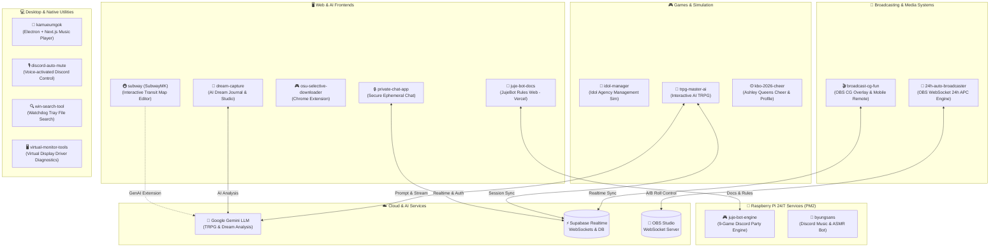

# 🌌 Antigravity Workspace Monorepo

[](https://opensource.org/licenses/MIT)
[](https://nodejs.org/)
[](https://www.python.org/)
[](https://www.electronjs.org/)
[](https://nextjs.org/)
[](https://react.dev/)
[](https://www.typescriptlang.org/)
[](https://obsproject.com/)
[](https://developer.chrome.com/docs/extensions/)
[](https://aistudio.google.com/)
[](https://supabase.com/)

> **방송 송출 자동화 시스템, 웹 애플리케이션, 인공지능 시뮬레이터, 아이돌 기획사 시뮬레이션 게임, 브라우저 확장 프로그램, 데스크톱 유틸리티를 망라한 올인원 모노레포(Monorepo) 워크스페이스입니다.**

---

## 🏛️ 시스템 아키텍처 다이어그램



---

## 📑 포함된 프로젝트 목록 (Projects Overview)

| 프로젝트명 | 분야 | 주요 기술 스택 | 핵심 설명 | 바로가기 |
| :--- | :---: | :--- | :--- | :---: |
| [**`24h-auto-broadcaster`**](./24h-auto-broadcaster/) | **Broadcasting** | Python 3, OBS WebSocket (`obsws-python`), OpenCV | DIMA 캡스톤디자인: A/B Roll 심리스 스위칭과 핫스왑을 지원하는 24시간 무인 자동 방송 송출 관제 시스템 | [README](./24h-auto-broadcaster/README.md) |
| [**`kbo-2026-cheer`**](./kbo-2026-cheer/) | **Game / Media** | Python 3, CustomTkinter, Pygame, Pillow, `keyboard`, `psutil` | SMB4 / KBO 가상 야구 '애슐리 퀸즈' 실시간 응원가(40곡), 22명 선수단 얼굴 프로필 전광판, 수비 다이아몬드 시각화 및 자동 실행 매니저 | [README](./kbo-2026-cheer/README.md) |
| [**`idol-manager`**](./idol-manager/) | **Game / Sim** | Python 3, PyQt/GUI, SQLite3, PyInstaller | 아이돌 스카우트, 트레이닝, 정규 리그전, 재무/급여 및 주간 성장을 시뮬레이션하는 풀스케일 기획사 경영 게임 | [README](./idol-manager/README.md) · [위키](https://idol-manager-wiki.vercel.app/) |
| [**`trpg-master-ai`**](./trpg-master-ai/) | **AI / Web** | Next.js 16, React 19, Google Gemini LLM, TailwindCSS, Supabase | D&D 5e 공식 룰셋과 창작 시나리오(군웅할거, 수미상관 등)를 기반으로 세션을 자율 진행하는 인터랙티브 TRPG 마스터 | [README](./trpg-master-ai/README.md) · [위키](https://trpgjsc.vercel.app/) |
| [**`broadcast-cg-fun`**](./broadcast-cg-fun/) | **Web / Media** | Next.js, React, Supabase Realtime, `react-player` | OBS 방송 화면 자막/영상 오버레이(`/screen`)와 스마트폰 원격 제어기(`/remote`), TTS를 실시간 연동하는 방송 솔루션 | [README](./broadcast-cg-fun/README.md) · [웹사이트](https://broadcast-cg-fun.vercel.app/) |
| [**`dream-capture`**](./dream-capture/) | **AI / Web** | React 19, Vite, `@google/genai` (Gemini), Better-SQLite3, Motion | 꿈 기록을 보관하고 Google Gemini AI를 통해 심층 심리 분석 및 해몽을 제공하는 스마트 드림 저널 플랫폼 | [README](./dream-capture/README.md) · [웹사이트](https://jaehofilm.vercel.app/) |
| [**`kamueumgok`**](./kamueumgok/) | **Desktop / Audio** | Electron 40, Next.js 16, React 19, Framer Motion, `music-metadata` | 로컬 음원 메타데이터 실시간 파싱과 감각적인 UI를 결합한 네이티브 데스크톱 음악 플레이어 (가무음곡) | [README](./kamueumgok/README.md) |
| [**`osu-selective-downloader`**](./osu-selective-downloader/) | **Extension** | Chrome Extension (V3), JavaScript, HTML5, Vite | osu! 웹사이트에서 원하는 난이도(Diff)만 골라서 가볍게 다운로드할 수 있는 브라우저 확장 프로그램 | [README](./osu-selective-downloader/README.md) · [AI Studio](https://ai.studio/apps/drive/1ZE8r9gbGy8d8XESfsf0MhYHvSI4Gqxao) |
| [**`juje-bot-engine`**](./juje-bot-engine/) | **Bot / Discord** | Python 3, `discord.py`, FFmpeg, PyNaCl, `yt-dlp` | 라즈베리파이 상주(PM2): 서바이벌, 라이어, 텔레파시, 탐정, 영웅시장 등 9개 파티게임을 자동 진행하는 8,290줄 메인 봇 엔진 | [README](./juje-bot-engine/README.md) · [룰북](https://juje-bot.vercel.app/) |
| [**`juje-bot-docs`**](./juje-bot-docs/) | **Web / Docs** | React 19, Vite, Tailwind CSS v4, Motion, Markdown | 주제어BOT 9개 미니게임 공식 룰북 및 전략을 제공하는 디스코드 테마 다크모드 가이드 웹 ([실서비스](https://juje-bot.vercel.app/)) | [README](./juje-bot-docs/README.md) · [웹사이트](https://juje-bot.vercel.app/) |
| [**`byungsans`**](./byungsans/) | **Bot / Discord** | Python 3, `discord.py`, `yt-dlp`, PyNaCl, FFmpeg | 라즈베리파이 상주(PM2): 유튜브 음악 스트리밍, 대기열, JSC 24/7 무한 라디오, ASMR 및 훈민정음 단어 퀴즈 디스코드 봇 | [README](./byungsans/README.md) |
| [**`private-chat-app`**](./private-chat-app/) | **Web / Chat** | Vite, React 19, TypeScript, Supabase Auth/Realtime, Oxlint | 초경량 고속 빌드 기반의 프라이빗 실시간 암호화 대화 및 알림음 지원 채팅 웹 | [README](./private-chat-app/README.md) · [웹사이트](https://private-chat-app-plum.vercel.app/) |
| [**`subway`**](./subway/) | **Web / Graphics** | React 19, Konva (`react-konva`), Vite, Tailwind CSS v4, TS | 인터랙티브 가상 지하철 및 버스 노선도 벡터 드로잉 웹 에디터 (10도 스냅, 역 도장, PNG 추출) | [README](./subway/README.md) · [웹사이트](https://subway-chi.vercel.app/) |
| [**`discord-auto-mute`**](./discord-auto-mute/) | **Desktop** | Python 3, `speech_recognition`, `pyaudio`, `pywin32`, `keyboard` | 마이크 음성을 인식하여 게임 중 손대지 않고 디스코드 음소거 및 통화 종료를 자동 실행하는 백그라운드 런처 | [README](./discord-auto-mute/README.md) |
| [**`win-search-tool`**](./win-search-tool/) | **Desktop** | Python 3, Tkinter, `watchdog`, `chardet`, PyInstaller | Windows 시스템 트레이에 상주하며 로컬 문서의 텍스트 본문과 파일명을 초고속 실시간 검색하는 데스크톱 툴 | [README](./win-search-tool/README.md) |
| [**`virtual-monitor-tools`**](./virtual-monitor-tools/) | **System** | Python (`mss`), PowerShell, Windows Driver | 가상 디스플레이(Virtual Display Driver)의 활성화 여부를 진단하고 UAC 권한으로 복구하는 시스템 도구 모음 | [README](./virtual-monitor-tools/README.md) |

---

## 📁 디렉토리 구조 (Directory Structure)

```text
antigravity-workspace/
├── 📄 .gitignore                 # 보안 토큰, 캐시, 대용량 진단로그 차단
├── 📄 README.md                  # 전체 프로젝트 허브 문서 (현재 파일)
│
├── 📂 24h-auto-broadcaster/      # OBS WebSocket 무인 자동 방송 송출 시스템 (Python)
│   ├── apc_main.py               # CMS, DPC, CDS, APC 4대 모듈 통합 송출 엔진
│   ├── drawing.pdf               # 시스템 계통도 및 시퀀스 설계도
│   └── README.md
│
├── 📂 idol-manager/              # 아이돌 기획사 육성 경영 시뮬레이션 게임 (Python)
├── 📂 kbo-2026-cheer/            # 애슐리 퀸즈 야구단 응원가 & 프로필 전광판 매니저 (Python)
├── 📂 osu-selective-downloader/  # osu! 비트맵 난이도 선택 다운로더 (Chrome Extension)
├── 📂 broadcast-cg-fun/          # 실시간 방송 CG 오버레이 & 리모컨 (Next.js)
├── 📂 discord-auto-mute/         # 음성인식 Discord 자동 음소거 매니저 (Python)
├── 📂 dream-capture/             # Google AI Studio 꿈 저널 & AI 분석 (Vite + Gemini)
├── 📂 juje-bot-docs/             # 주제어 봇 게임 규칙 설명서 웹 (React 19 + Vercel)
├── 📂 juje-bot-engine/           # 라즈베리파이 PM2 주제어 디스코드 봇 메인 서버 (Python)
├── 📂 byungsans/                 # 라즈베리파이 PM2 음악 & ASMR 디스코드 봇 (Python)
├── 📂 kamueumgok/                # Electron + Next.js 데스크톱 음악 플레이어 (가무음곡)
├── 📂 private-chat-app/          # 초경량 실시간 보안 채팅 웹 (Vite + React 19)
├── 📂 subway/                    # 가상 지하철·노선도 벡터 드로잉 에디터 (React 19 + Konva)
├── 📂 trpg-master-ai/            # Gemini AI 기반 인터랙티브 TRPG 마스터 (Next.js 16)
├── 📂 win-search-tool/           # 트레이 로컬 파일/내용 실시간 검색기 (Python)
└── 📂 virtual-monitor-tools/     # 가상 모니터 드라이버 진단 및 복구 스크립트
```

---

## 🔒 보안 및 환경 변수 관리

- **API 키 및 시크릿 토큰 보호**: 
  - 실제 API 키(`Gemini API Key`, `Supabase Key` 등)가 저장된 `.env` 및 `.env.local` 파일은 루트 및 각 하위 프로젝트의 `.gitignore`에 의해 Git 추적 대상에서 **완벽히 차단**되어 있습니다.
- **환경 변수 세팅 방법**:
  - 각 웹 프로젝트 폴더에 진입하여 `.env.example` 파일을 복사해 `.env.local` (또는 `.env`)을 생성한 후 본인의 키를 입력하세요.

---

## 🚀 데스크톱 프로그램 원클릭 실행 (Zero-Config One-Click Launch)

노트북이나 새로운 PC에서 번거롭게 터미널(CMD)을 열고 패키지를 수동 설치할 필요 없이, **더블클릭 한 번으로 필요한 런타임/의존성을 자동 감지하여 설치 및 실행**할 수 있는 원클릭 실행기를 제공합니다.

### 🌟 1. 올인원 마스터 통합 실행기
저장소 최상단 루트의 **[`프로그램_통합_실행기.bat`](./프로그램_통합_실행기.bat)** (또는 [`JSC_Launcher.bat`](./JSC_Launcher.bat))를 더블클릭하면 인터랙티브 콘솔 메뉴를 통해 원하는 데스크톱 프로그램을 즉시 실행할 수 있습니다:
- **`[1]` 🎵 가무음곡 (KaMuEumGok)**: 감성 데스크톱 음악 플레이어 (Next.js + Electron 자동 패키징 설치)
- **`[2]` 👑 IDOL Manager**: K-POP 기획사 육성 경영 시뮬레이션 게임 (PySide6)
- **`[3]` ⚾ KBO 2026 애슐리 퀸즈**: 실시간 응원가(40곡) & 선수단 프로필 전광판
- **`[4]` 🎙️ DiscordAutoMute**: 마이크 음성인식 디스코드 자동 음소거 (독립 EXE 내장)
- **`[5]` 🔍 win-search-tool**: Windows 로컬 문서 본문 초고속 실시간 검색기 (독립 EXE 내장)
- **`[6]` 📡 24h-auto-broadcaster**: DIMA 24시간 무인 자동 방송 송출 관제 시스템 (OBS)
- **`[7]` 🖥️ virtual-monitor-tools**: 가상 디스플레이 진단 및 원클릭 복구

### 📂 2. 개별 프로그램 폴더별 단독 실행 (`실행하기.bat`)
특정 프로그램 폴더만 별도로 다운로드받은 경우에도, 각 폴더 안의 **`실행하기.bat`** (또는 `.exe`)만 더블클릭하면 자동으로 의존성 검사 및 실행이 완료됩니다:

| 프로그램 | 원클릭 실행 파일 | 배포 및 실행 방식 |
| :--- | :--- | :--- |
| **`kamueumgok`** | [`실행하기.bat`](./kamueumgok/실행하기.bat) · [`KaMuEumGok.bat`](./kamueumgok/KaMuEumGok.bat) | Node/Electron 라이브러리 자동 감지/설치 후 즉시 앱 실행 |
| **`win-search-tool`** | [`실행하기.bat`](./win-search-tool/실행하기.bat) · [`dist\local_search_tray.exe`](./win-search-tool/dist/local_search_tray.exe) | 독립 실행 파일(EXE) 기본 탑재 (Python 설치 불필요) |
| **`discord-auto-mute`** | [`실행하기.bat`](./discord-auto-mute/실행하기.bat) · [`dist\discord_mute.exe`](./discord-auto-mute/dist/discord_mute.exe) | 독립 실행 파일(EXE) 기본 탑재 (Python 설치 불필요) |
| **`kbo-2026-cheer`** | [`실행하기.bat`](./kbo-2026-cheer/실행하기.bat) · [`SMB4_게임실행.bat`](./kbo-2026-cheer/SMB4_게임실행.bat) | CustomTkinter, Pygame 라이브러리 자동 점검 및 실행 |
| **`idol-manager`** | [`실행하기.bat`](./idol-manager/실행하기.bat) · [`start.bat`](./idol-manager/start.bat) | Windows VBS 가상환경 부트스트랩 및 GUI 실행 |
| **`24h-auto-broadcaster`** | [`실행하기.bat`](./24h-auto-broadcaster/실행하기.bat) | OBS WebSocket, OpenCV 자동 점검 및 24시간 APC 송출 실행 |
| **`virtual-monitor-tools`** | [`가상모니터_복구_실행.bat`](./virtual-monitor-tools/가상모니터_복구_실행.bat) | 관리자 권한 자동 획득 및 가상 디스플레이 드라이버 복구 |

---

## 👨‍💻 개발자 정보 (Developer Information)

- **Developer**: **정승찬 (jscsarik)**
- **GitHub**: [https://github.com/jscsarik](https://github.com/jscsarik)
- **Repository**: [jscsarik/jsc_projects](https://github.com/jscsarik/jsc_projects)

---

## 📜 라이선스

This project is licensed under the MIT License.
