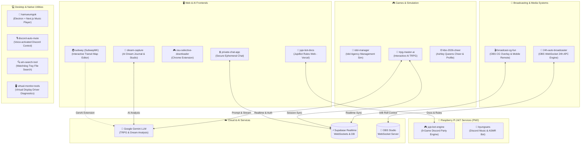

# 🌌 JSC Projects Monorepo (정승찬 프로젝트 모음집)

[-blue.svg)](https://github.com/jscsarik)
[](https://opensource.org/licenses/MIT)
[](https://nodejs.org/)
[](https://www.python.org/)
[](https://www.electronjs.org/)
[](https://nextjs.org/)

> **"컴퓨터를 잘 몰라도 괜찮습니다! 검은 창(CMD/터미널)에 복잡한 영어 명령어 칠 필요 없이, 마우스 더블클릭만 하면 모든 프로그램이 알아서 켜집니다."**  
> 감성 음악 플레이어, AI 시뮬레이터, 실시간 야구 응원가 및 전광판, 디스코드 봇, 초고속 검색기, 24시간 무인 방송 송출 시스템까지 한곳에 모아둔 올인원 워크스페이스입니다.

---

## 🔰 [초간단] 컴맹도 3초 만에 실행하는 법 (필독 가이드)

노트북이나 새 컴퓨터에서 **프로그램을 어떻게 켜야 할지 모르겠다면 아래 3단계만 그대로 따라 하세요!**

```
[1단계] GitHub에서 압축파일(ZIP) 다운받고 압축 풀기
  ▼
[2단계] '프로그램_통합_실행기.bat' 마우스 더블클릭하기
  ▼
[3단계] 번호만 누르면 프로그램 자동 실행 완료! (끝)
```

### 1단계: 내 컴퓨터로 다운로드받기
1. 이 GitHub 페이지 우측 상단에 있는 초록색 **`<> Code`** 버튼을 클릭합니다.
2. 맨 아래에 나오는 **`Download ZIP`** 을 클릭하여 압축 파일을 다운받습니다.
3. 다운로드받은 파일의 압축을 풉니다 (바탕화면, 내 문서, C드라이브 등 편한 곳).

---

### 2단계: 마우스로 더블클릭만 하세요!

#### 💡 방법 A. [가장 추천] 모든 프로그램을 한 곳에서 골라 켜기
압축을 푼 폴더 맨 위에 있는 **[`프로그램_통합_실행기.bat`](./프로그램_통합_실행기.bat)** (또는 [`JSC_Launcher.bat`](./JSC_Launcher.bat))를 **마우스로 더블클릭**하세요!
- 검은색 화면에 1번부터 7번까지 프로그램 번호 목록이 뜹니다.
- 켜고 싶은 프로그램의 **번호를 키보드로 입력하고 엔터(Enter)** 를 누르면 알아서 준비되고 실행됩니다!

#### 💡 방법 B. 원하는 프로그램 폴더로 직접 들어가서 켜기
폴더 안에 직접 들어가서 **`실행하기.bat`** 또는 **`.exe`** 파일만 마우스로 더블클릭하면 됩니다:

| 내가 쓰고 싶은 프로그램 | 들어갈 폴더 이름 | 마우스로 더블클릭할 파일 | 초보자 안내 (참고사항) |
| :--- | :--- | :--- | :--- |
| 🎵 **가무음곡** (감성 음악 플레이어) | [`kamueumgok`](./kamueumgok/) | **`실행하기.bat`** | 필요한 부품을 알아서 조립한 후 예쁜 플레이어 창이 뜹니다. |
| 🔍 **초고속 파일/문서 실시간 검색기** | [`win-search-tool`](./win-search-tool/) | **`dist` ➔ `local_search_tray.exe`** (또는 `실행하기.bat`) | **아무것도 설치할 필요 없음!** 더블클릭하자마자 검색창과 트레이 아이콘이 즉시 켜집니다. |
| 🎙️ **디스코드 마이크 음성 자동 음소거** | [`discord-auto-mute`](./discord-auto-mute/) | **`dist` ➔ `discord_mute.exe`** (또는 `실행하기.bat`) | **아무것도 설치할 필요 없음!** 누르자마자 콘솔 창에서 마이크 음성 감지를 시작합니다. |
| ⚾ **야구 응원가 40곡 & 선수단 전광판** | [`kbo-2026-cheer`](./kbo-2026-cheer/) | **`dist` ➔ `kbo_cheer.exe`** (또는 `실행하기.bat`) | **Python 없이도 즉시 실행!** 응원가/등장곡 오디오와 수비 다이아몬드 전광판이 바로 켜집니다. |
| 👑 **K-POP 아이돌 기획사 육성 게임** | [`idol-manager`](./idol-manager/) | **`실행하기.bat`** | 아이돌을 키우고 리그전을 치르는 기획사 경영 시뮬레이션 게임 창이 뜹니다. |
| 📡 **24시간 무인 방송 송출 시스템** | [`24h-auto-broadcaster`](./24h-auto-broadcaster/) | **`실행하기.bat`** | OBS 방송 송출 및 핫스왑 자동 스위칭 엔진을 구동합니다. |
| 🖥️ **가상 모니터 드라이버 진단/복구** | [`virtual-monitor-tools`](./virtual-monitor-tools/) | **`실행하기.bat`** | 가상 디스플레이가 꼬였을 때 원클릭으로 자동 진단 및 복구합니다. |

---

### 3단계: ❓ 컴맹을 위한 자주 묻는 질문 (FAQ)

> **Q1. `실행하기.bat`를 눌렀는데 까만 창이 뜨고 글자가 막 올라가요. 고장 난 건가요?**  
> 👉 **절대 고장이 아닙니다! 안심하세요.**  
> 프로그램을 처음 실행할 때 컴퓨터에 꼭 필요한 부품(라이브러리)들을 인터넷에서 스스로 다운받아 조립해 주는 중입니다. **약 10초~30초 정도만 아무것도 누르지 마시고 가만히 기다리시면** 프로그램 화면이 짠 하고 나타납니다. (두 번째 켤 때부터는 기다림 없이 즉시 켜집니다!)

> **Q2. 빨간 글씨로 "Node.js가 설치되어 있지 않습니다" 또는 "Python이 없습니다"라고 떠요!**  
> 👉 컴퓨터에 기본 엔진이 없다는 뜻입니다. 아래 공식 링크에서 파일 딱 하나만 받아서 **[다음(Next)]** 만 계속 누르고 설치해 주시면 평생 다시는 안 뜹니다:
> - 가무음곡(음악 플레이어)을 켤 때: 👉 [Node.js 공식 다운로드 (초록색 LTS 버튼 클릭)](https://nodejs.org/)
> - 기타 파이썬 프로그램을 켤 때: 👉 [Python 공식 다운로드](https://www.python.org/downloads/) *(⚠️ 설치 창 맨 아래에 있는 **'Add python.exe to PATH'** 체크박스를 꼭 체크해 주세요!)*
> - 💡 **참고**: `win-search-tool`과 `discord-auto-mute`는 `dist` 폴더 안에 있는 **`.exe`** 파일만 누르면 Node.js나 Python이 **전혀 없어도 바로 켜집니다!**

---

## 🌐 다운로드 없이 클릭만 하면 스마트폰/PC에서 바로 열리는 웹사이트

프로그램을 내 컴퓨터에 다운로드받을 필요도 없이, **인터넷 주소(링크)만 누르면 스마트폰이나 노트북 웹 브라우저에서 바로 사용할 수 있는 사이트 목록**입니다:

| 사이트 이름 | 하는 일 | 바로 가기 (클릭) |
| :--- | :--- | :--- |
| 🌙 **Dream Capture (드림 캡처)** | AI가 내가 어젯밤 꾼 꿈을 심리 분석하고 해몽해 주는 꿈 일기장 | 👉 [https://jaehofilm.vercel.app/](https://jaehofilm.vercel.app/) |
| 🔒 **Private Chat App (비밀 채팅)** | 서버에 기록이 남지 않고 알림음이 울리는 일회용 보안 메신저 | 👉 [https://private-chat-app-plum.vercel.app/](https://private-chat-app-plum.vercel.app/) |
| 🚇 **Subway (노선도 그리기)** | 내 손으로 직접 가상 지하철·버스 노선도를 그리고 이미지로 저장하는 도구 | 👉 [https://subway-chi.vercel.app/](https://subway-chi.vercel.app/) |
| 🐉 **TRPG Master AI** | 주사위를 굴리며 인공지능 마스터와 함께 즐기는 판타지 TRPG 모험 게임 | 👉 [https://trpgjsc.vercel.app/](https://trpgjsc.vercel.app/) |
| 🎬 **방송 자막 CG & 스마트폰 리모컨** | 방송 화면에 자막과 영상을 띄우고 스마트폰으로 실시간 조종하는 리모컨 | 👉 [https://broadcast-cg-fun.vercel.app/](https://broadcast-cg-fun.vercel.app/) |
| 📖 **주제어BOT 9개 미니게임 룰북** | 디스코드 봇이 진행하는 9가지 파티게임 공식 전략 및 룰 설명서 웹 | 👉 [https://juje-bot.vercel.app/](https://juje-bot.vercel.app/) |
| 👑 **아이돌 매니저 공식 위키** | K-POP 아이돌 기획사 육성 게임의 데이터베이스와 공식 공략집 | 👉 [https://idol-manager-wiki.vercel.app/](https://idol-manager-wiki.vercel.app/) |
| 🎮 **osu! 난이도 선택 다운로더** | osu! 웹사이트에서 원하는 난이도만 골라서 다운받는 크롬 확장 프로그램 | 👉 [Chrome 확장 도구](https://ai.studio/apps/drive/1ZE8r9gbGy8d8XESfsf0MhYHvSI4Gqxao) |

---

## 🏛️ 시스템 아키텍처 다이어그램 (전체 기술 구조도)



---

## 📑 포함된 프로젝트 전체 목록 (Projects Overview)

| 프로젝트명 | 분야 | 주요 기술 스택 | 핵심 설명 | 바로가기 |
| :--- | :---: | :--- | :--- | :---: |
| [**`kamueumgok`**](./kamueumgok/) | **Desktop / Audio** | Electron 40, Next.js 16, React 19, Framer Motion, `music-metadata` | 로컬 음원 메타데이터 실시간 파싱과 감각적인 UI를 결합한 네이티브 데스크톱 음악 플레이어 (가무음곡) | [README](./kamueumgok/README.md) |
| [**`kbo-2026-cheer`**](./kbo-2026-cheer/) | **Game / Media** | Python 3, CustomTkinter, Pygame, Pillow, `keyboard`, `psutil` | SMB4 / KBO 가상 야구 '애슐리 퀸즈' 실시간 응원가(40곡), 22명 선수단 얼굴 프로필 전광판, 수비 다이아몬드 시각화 및 자동 실행 매니저 | [README](./kbo-2026-cheer/README.md) |
| [**`win-search-tool`**](./win-search-tool/) | **Desktop** | Python 3, Tkinter, `watchdog`, `chardet`, PyInstaller | Windows 시스템 트레이에 상주하며 로컬 문서의 텍스트 본문과 파일명을 초고속 실시간 검색하는 데스크톱 툴 (단독 EXE 내장) | [README](./win-search-tool/README.md) |
| [**`discord-auto-mute`**](./discord-auto-mute/) | **Desktop** | Python 3, `speech_recognition`, `pyaudio`, `pywin32`, `keyboard` | 마이크 음성을 인식하여 게임 중 손대지 않고 디스코드 음소거 및 통화 종료를 자동 실행하는 백그라운드 런처 (단독 EXE 내장) | [README](./discord-auto-mute/README.md) |
| [**`idol-manager`**](./idol-manager/) | **Game / Sim** | Python 3, PyQt/GUI, SQLite3, PyInstaller | 아이돌 스카우트, 트레이닝, 정규 리그전, 재무/급여 및 주간 성장을 시뮬레이션하는 풀스케일 기획사 경영 게임 | [README](./idol-manager/README.md) · [위키](https://idol-manager-wiki.vercel.app/) |
| [**`24h-auto-broadcaster`**](./24h-auto-broadcaster/) | **Broadcasting** | Python 3, OBS WebSocket (`obsws-python`), OpenCV | DIMA 캡스톤디자인: A/B Roll 심리스 스위칭과 핫스왑을 지원하는 24시간 무인 자동 방송 송출 관제 시스템 | [README](./24h-auto-broadcaster/README.md) |
| [**`virtual-monitor-tools`**](./virtual-monitor-tools/) | **System** | Python (`mss`), PowerShell, Windows Driver | 가상 디스플레이(Virtual Display Driver)의 활성화 여부를 진단하고 UAC 권한으로 복구하는 시스템 도구 모음 | [README](./virtual-monitor-tools/README.md) |
| [**`dream-capture`**](./dream-capture/) | **AI / Web** | React 19, Vite, `@google/genai` (Gemini), Better-SQLite3, Motion | 꿈 기록을 보관하고 Google Gemini AI를 통해 심층 심리 분석 및 해몽을 제공하는 스마트 드림 저널 플랫폼 | [README](./dream-capture/README.md) · [웹사이트](https://jaehofilm.vercel.app/) |
| [**`trpg-master-ai`**](./trpg-master-ai/) | **AI / Web** | Next.js 16, React 19, Google Gemini LLM, TailwindCSS, Supabase | D&D 5e 공식 룰셋과 창작 시나리오(군웅할거, 수미상관 등)를 기반으로 세션을 자율 진행하는 인터랙티브 TRPG 마스터 | [README](./trpg-master-ai/README.md) · [위키](https://trpgjsc.vercel.app/) |
| [**`broadcast-cg-fun`**](./broadcast-cg-fun/) | **Web / Media** | Next.js, React, Supabase Realtime, `react-player` | OBS 방송 화면 자막/영상 오버레이(`/screen`)와 스마트폰 원격 제어기(`/remote`), TTS를 실시간 연동하는 방송 솔루션 | [README](./broadcast-cg-fun/README.md) · [웹사이트](https://broadcast-cg-fun.vercel.app/) |
| [**`private-chat-app`**](./private-chat-app/) | **Web / Chat** | Vite, React 19, TypeScript, Supabase Auth/Realtime, Oxlint | 초경량 고속 빌드 기반의 프라이빗 실시간 암호화 대화 및 알림음 지원 채팅 웹 | [README](./private-chat-app/README.md) · [웹사이트](https://private-chat-app-plum.vercel.app/) |
| [**`subway`**](./subway/) | **Web / Graphics** | React 19, Konva (`react-konva`), Vite, Tailwind CSS v4, TS | 인터랙티브 가상 지하철 및 버스 노선도 벡터 드로잉 웹 에디터 (10도 스냅, 역 도장, PNG 추출) | [README](./subway/README.md) · [웹사이트](https://subway-chi.vercel.app/) |
| [**`osu-selective-downloader`**](./osu-selective-downloader/) | **Extension** | Chrome Extension (V3), JavaScript, HTML5, Vite | osu! 웹사이트에서 원하는 난이도(Diff)만 골라서 가볍게 다운로드할 수 있는 브라우저 확장 프로그램 | [README](./osu-selective-downloader/README.md) · [AI Studio](https://ai.studio/apps/drive/1ZE8r9gbGy8d8XESfsf0MhYHvSI4Gqxao) |
| [**`juje-bot-engine`**](./juje-bot-engine/) | **Bot / Discord** | Python 3, `discord.py`, FFmpeg, PyNaCl, `yt-dlp` | 라즈베리파이 상주(PM2): 서바이벌, 라이어, 텔레파시, 탐정, 영웅시장 등 9개 파티게임을 자동 진행하는 8,290줄 메인 봇 엔진 | [README](./juje-bot-engine/README.md) · [룰북](https://juje-bot.vercel.app/) |
| [**`juje-bot-docs`**](./juje-bot-docs/) | **Web / Docs** | React 19, Vite, Tailwind CSS v4, Motion, Markdown | 주제어BOT 9개 미니게임 공식 룰북 및 전략을 제공하는 디스코드 테마 다크모드 가이드 웹 ([실서비스](https://juje-bot.vercel.app/)) | [README](./juje-bot-docs/README.md) · [웹사이트](https://juje-bot.vercel.app/) |
| [**`byungsans`**](./byungsans/) | **Bot / Discord** | Python 3, `discord.py`, `yt-dlp`, PyNaCl, FFmpeg | 라즈베리파이 상주(PM2): 유튜브 음악 스트리밍, 대기열, JSC 24/7 무한 라디오, ASMR 및 훈민정음 단어 퀴즈 디스코드 봇 | [README](./byungsans/README.md) |

---

## 📁 디렉토리 구조 (Directory Structure)

```text
jsc_projects/
├── 📄 .gitignore                 # 보안 토큰, 캐시, 대용량 진단로그 차단
├── 📄 README.md                  # 전체 프로젝트 허브 문서 (현재 파일)
├── ⚡ 프로그램_통합_실행기.bat     # [컴맹 추천] 데스크톱 프로그램 올인원 통합 실행기
├── ⚡ JSC_Launcher.bat           # 통합 실행기 영문 파일명 바로가기
│
├── 📂 kamueumgok/                # Electron + Next.js 데스크톱 음악 플레이어 (가무음곡)
│   ├── 실행하기.bat               # 원클릭 자동 설치 및 실행기
│   └── ...
├── 📂 win-search-tool/           # 트레이 로컬 파일/내용 실시간 검색기
│   ├── dist/local_search_tray.exe # [독립 실행] 무설치 EXE 실행 파일
│   └── 실행하기.bat
├── 📂 discord-auto-mute/         # 음성인식 Discord 자동 음소거 매니저
│   ├── dist/discord_mute.exe     # [독립 실행] 무설치 EXE 실행 파일
│   └── 실행하기.bat
├── 📂 kbo-2026-cheer/            # 애슐리 퀸즈 야구단 응원가 & 프로필 전광판
│   └── 실행하기.bat
├── 📂 idol-manager/              # 아이돌 기획사 육성 경영 시뮬레이션 게임
│   └── 실행하기.bat
├── 📂 24h-auto-broadcaster/      # OBS WebSocket 무인 자동 방송 송출 시스템
│   └── 실행하기.bat
├── 📂 virtual-monitor-tools/     # 가상 모니터 드라이버 진단 및 복구 도구
│   └── 가상모니터_복구_실행.bat
│
├── 📂 dream-capture/             # Google AI Studio 꿈 저널 & AI 분석 웹
├── 📂 trpg-master-ai/            # Gemini AI 기반 인터랙티브 TRPG 마스터 웹
├── 📂 broadcast-cg-fun/          # 실시간 방송 CG 오버레이 & 모바일 리모컨
├── 📂 private-chat-app/          # 초경량 실시간 보안 채팅 웹
├── 📂 subway/                    # 가상 지하철·노선도 벡터 드로잉 웹 에디터
├── 📂 osu-selective-downloader/  # osu! 비트맵 난이도 선택 다운로더 (Chrome 확장)
├── 📂 juje-bot-docs/             # 주제어 봇 게임 규칙 설명서 웹
├── 📂 juje-bot-engine/           # 라즈베리파이 PM2 주제어 디스코드 봇 메인 서버
└── 📂 byungsans/                 # 라즈베리파이 PM2 음악 & ASMR 디스코드 봇
```

---

## 🔒 보안 및 환경 변수 관리

- **API 키 및 시크릿 토큰 보호**: 
  - 실제 API 키(`Gemini API Key`, `Supabase Key` 등)가 저장된 `.env` 및 `.env.local` 파일은 루트 및 각 하위 프로젝트의 `.gitignore`에 의해 Git 추적 대상에서 **완벽히 차단**되어 안전합니다.
- **환경 변수 세팅 방법**:
  - 각 웹 프로젝트 폴더에 진입하여 `.env.example` 파일을 복사해 `.env.local` (또는 `.env`)을 생성한 후 본인의 키를 입력하세요.

---

## 👨‍💻 개발자 정보 (Developer Information)

- **개발자**: **정승찬 (jscsarik)**
- **GitHub**: [https://github.com/jscsarik](https://github.com/jscsarik)
- **저장소**: [https://github.com/jscsarik/jsc_projects](https://github.com/jscsarik/jsc_projects)

---

## 📜 라이선스

This project is licensed under the MIT License.
