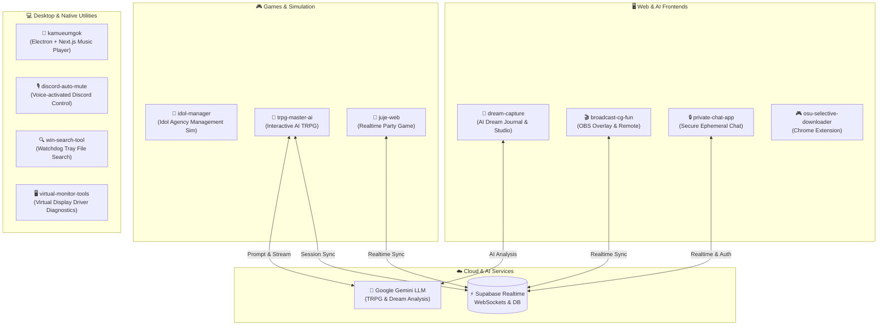

# 🌌 Antigravity Workspace Monorepo

[](https://opensource.org/licenses/MIT)
[](https://nodejs.org/)
[](https://www.python.org/)
[](https://www.electronjs.org/)
[](https://nextjs.org/)
[](https://react.dev/)
[](https://www.typescriptlang.org/)
[](https://developer.chrome.com/docs/extensions/)
[](https://aistudio.google.com/)
[](https://supabase.com/)

> **웹 애플리케이션, 인공지능 시뮬레이터, 아이돌 기획사 경영 시뮬레이션 게임, 브라우저 확장 프로그램, 데스크톱 유틸리티를 망라한 올인원 모노레포(Monorepo) 워크스페이스입니다.**

---

## 🏛️ 시스템 아키텍처 다이어그램



---

## 📑 포함된 프로젝트 목록 (Projects Overview)

| 프로젝트명 | 분야 | 주요 기술 스택 | 핵심 설명 | 바로가기 |
| :--- | :---: | :--- | :--- | :---: |
| [**`idol-manager`**](./idol-manager/) | **Game / Sim** | Python 3, PyQt/GUI, SQLite3, PyInstaller | 아이돌 스카우트, 트레이닝, 정규 리그전, 재무/급여 및 주간 성장을 시뮬레이션하는 풀스케일 기획사 경영 게임 | [README](./idol-manager/README.md) |
| [**`trpg-master-ai`**](./trpg-master-ai/) | **AI / Web** | Next.js 16, React 19, Google Gemini LLM, TailwindCSS, Supabase | D&D 5e 공식 룰셋과 창작 시나리오(군웅할거, 수미상관 등)를 기반으로 세션을 자율 진행하는 인터랙티브 TRPG 마스터 | [README](./trpg-master-ai/README.md) |
| [**`dream-capture`**](./dream-capture/) | **AI / Web** | React 19, Vite, `@google/genai` (Gemini), Better-SQLite3, Motion | 꿈 기록을 보관하고 Google Gemini AI를 통해 심층 심리 분석 및 해몽을 제공하는 스마트 드림 저널 플랫폼 | [README](./dream-capture/README.md) |
| [**`kamueumgok`**](./kamueumgok/) | **Desktop / Audio** | Electron 40, Next.js 16, React 19, Framer Motion, `music-metadata` | 로컬 음원 메타데이터 실시간 파싱과 감각적인 UI를 결합한 네이티브 데스크톱 음악 플레이어 (가무음곡) | [README](./kamueumgok/README.md) |
| [**`osu-selective-downloader`**](./osu-selective-downloader/) | **Extension** | Chrome Extension (V3), JavaScript, HTML5, Vite | osu! 웹사이트에서 원하는 난이도(Diff)만 골라서 가볍게 다운로드할 수 있는 브라우저 확장 프로그램 | [README](./osu-selective-downloader/README.md) |
| [**`broadcast-cg-fun`**](./broadcast-cg-fun/) | **Web / Media** | Next.js, React, Supabase Realtime, `react-player` | OBS 방송 화면 자막/영상 오버레이(`/screen`)와 스마트폰 원격 제어기(`/remote`), TTS를 실시간 연동하는 방송 솔루션 | [README](./broadcast-cg-fun/README.md) |
| [**`juje-web`**](./juje-web/) | **Web / Game** | Next.js 16, React 19, Supabase Realtime, TailwindCSS v4 | 실시간 룸 생성, 라이어/추리 모드, 타이머 및 상황별 사운드 이펙트를 제공하는 보드게임 웹 클라이언트 | [README](./juje-web/README.md) |
| [**`private-chat-app`**](./private-chat-app/) | **Web / Chat** | Vite, React 19, TypeScript, Supabase Auth/Realtime, Oxlint | 초경량 고속 빌드 기반의 프라이빗 실시간 암호화 대화 및 알림음 지원 채팅 웹 | [README](./private-chat-app/README.md) |
| [**`discord-auto-mute`**](./discord-auto-mute/) | **Desktop** | Python 3, `speech_recognition`, `pyaudio`, `pywin32`, `keyboard` | 마이크 음성을 인식하여 게임 중 손대지 않고 디스코드 음소거 및 통화 종료를 자동 실행하는 백그라운드 런처 | [README](./discord-auto-mute/README.md) |
| [**`win-search-tool`**](./win-search-tool/) | **Desktop** | Python 3, Tkinter, `watchdog`, `chardet`, PyInstaller | Windows 시스템 트레이에 상주하며 로컬 문서의 텍스트 본문과 파일명을 초고속 실시간 검색하는 데스크톱 툴 | [README](./win-search-tool/README.md) |
| [**`virtual-monitor-tools`**](./virtual-monitor-tools/) | **System** | Python (`mss`), PowerShell, Windows Driver | 가상 디스플레이(Virtual Display Driver)의 활성화 여부를 진단하고 UAC 권한으로 복구하는 시스템 도구 모음 | [README](./virtual-monitor-tools/README.md) |

---

## 📁 디렉토리 구조 (Directory Structure)

```text
antigravity-workspace/
├── 📄 .gitignore                 # 보안 토큰, 캐시, 대용량 진단로그 차단
├── 📄 README.md                  # 전체 프로젝트 허브 문서 (현재 파일)
│
├── 📂 idol-manager/              # 아이돌 기획사 육성 경영 시뮬레이션 게임 (Python)
│   ├── idol_manager/             # 게임 코어 로직, UI 컨트롤러, 데이터 모델
│   ├── assets/                   # 아이돌 일러스트, 음원, UI 그래픽
│   ├── docs/                     # 시스템 기획서 및 패치노트
│   └── README.md
│
├── 📂 osu-selective-downloader/  # osu! 비트맵 난이도 선택 다운로더 (Chrome Extension)
│   ├── manifest.json             # Manifest V3 확장 프로그램 매니페스트
│   ├── popup.html / popup.js     # 난이도 선택 팝업 UI
│   └── README.md
│
├── 📂 broadcast-cg-fun/          # 실시간 방송 CG 오버레이 & 리모컨 (Next.js)
├── 📂 discord-auto-mute/         # 음성인식 Discord 자동 음소거 매니저 (Python)
├── 📂 dream-capture/             # Google AI Studio 꿈 저널 & AI 분석 (Vite + Gemini)
├── 📂 juje-web/                  # '주제어' 추리 파티게임 웹 클라이언트 (Next.js 16)
├── 📂 kamueumgok/                # Electron + Next.js 데스크톱 음악 플레이어 (가무음곡)
├── 📂 private-chat-app/          # 초경량 실시간 보안 채팅 웹 (Vite + React 19)
├── 📂 trpg-master-ai/            # Gemini AI 기반 인터랙티브 TRPG 마스터 (Next.js 16)
├── 📂 win-search-tool/           # 트레이 로컬 파일/내용 실시간 검색기 (Python)
└── 📂 virtual-monitor-tools/     # 가상 모니터 드라이버 진단 및 복구 스크립트
```

---

## 🔒 보안 및 환경 변수 관리

- **API 키 및 시크릿 토큰 보호**: 
  - 실제 API 키(`Gemini API Key`, `Supabase Key` 등)가 저장된 `.env` 및 `.env.local` 파일은 루트 및 각 하위 프로젝트의 `.gitignore`에 의해 Git 추적 대상에서 **완벽히 차단**되어 있습니다.
- **환경 변수 세팅 방법**:
  - 각 웹 프로젝트 폴더에 진입하여 `.env.example` 파일을 복사해 `.env.local` (또는 `.env`)을 생성한 후 본인의 키를 입력하세요.

---

## ⚡ 프로젝트별 실행 가이드 (Quick Start)

### 1. 아이돌 매니저 실행 (`idol-manager`)
```bash
cd idol-manager
pip install -r requirements.txt
python main.py
# 또는 폴더 내의 실행하기.bat 더블 클릭
```

### 2. osu! 확장 프로그램 로드 (`osu-selective-downloader`)
1. Chrome 브라우저에서 `chrome://extensions/` 이동 후 **[개발자 모드]** 활성화
2. **[압축해제된 확장 프로그램을 로드합니다]** 클릭 후 `osu-selective-downloader` 폴더 선택

### 3. Web & AI 프로젝트 실행 (`trpg-master-ai`, `dream-capture`, `juje-web` 등)
```bash
cd trpg-master-ai
npm install
npm run dev
```

### 4. 데스크톱 앱 실행 (`kamueumgok`)
```bash
cd kamueumgok
npm install
npm run electron:dev
```

---

## 📜 라이선스

This project is licensed under the MIT License.
