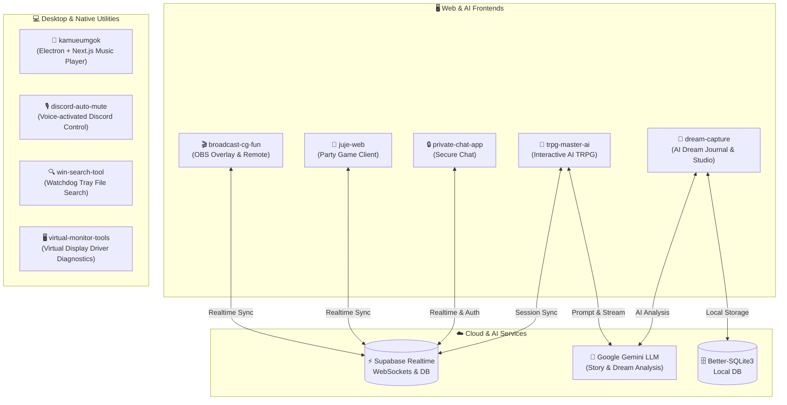

# 🌌 Antigravity Workspace Monorepo

[](https://opensource.org/licenses/MIT)
[](https://nodejs.org/)
[](https://www.python.org/)
[](https://nextjs.org/)
[](https://react.dev/)
[](https://www.electronjs.org/)
[](https://www.typescriptlang.org/)
[](https://aistudio.google.com/)
[](https://supabase.com/)

> **웹 애플리케이션, 인공지능 시뮬레이터, 데스크톱 플레이어, 시스템 유틸리티를 한곳에 집약한 올인원 모노레포(Monorepo) 워크스페이스입니다.**

---

## 🏛️ 시스템 아키텍처 다이어그램



---

## 📑 포함된 프로젝트 목록 (Projects Overview)

| 프로젝트명 | 분야 | 주요 기술 스택 | 핵심 설명 | 바로가기 |
| :--- | :---: | :--- | :--- | :---: |
| [**`trpg-master-ai`**](./trpg-master-ai/) | **AI / Web** | Next.js 16, React 19, Google Gemini LLM, TailwindCSS, Supabase | D&D 5e 공식 룰셋과 창작 시나리오(군웅할거, 수미상관 등)를 기반으로 세션을 자율 진행하는 인터랙티브 TRPG 마스터 | [README](./trpg-master-ai/README.md) |
| [**`dream-capture`**](./dream-capture/) | **AI / Web** | React 19, Vite, `@google/genai` (Gemini), Better-SQLite3, Express, Motion | 꿈 기록을 보관하고 Google Gemini AI를 통해 심층 심리 분석 및 해몽을 제공하는 스마트 드림 저널 플랫폼 | [README](./dream-capture/README.md) |
| [**`kamueumgok`**](./kamueumgok/) | **Desktop / Audio** | Electron 40, Next.js 16, React 19, Framer Motion, `music-metadata` | 로컬 음원 메타데이터 실시간 파싱과 감각적인 UI를 결합한 네이티브 데스크톱 음악 플레이어 (가무음곡) | [README](./kamueumgok/README.md) |
| [**`broadcast-cg-fun`**](./broadcast-cg-fun/) | **Web / Media** | Next.js, React, Supabase Realtime, `react-player` | OBS 방송 화면 자막/영상 오버레이(`/screen`)와 스마트폰 원격 제어기(`/remote`), TTS를 실시간 연동하는 방송 솔루션 | [README](./broadcast-cg-fun/README.md) |
| [**`juje-web`**](./juje-web/) | **Web / Game** | Next.js 16, React 19, Supabase Realtime, TailwindCSS v4 | 실시간 룸 생성, 라이어/추리 모드, 타이머 및 상황별 사운드 이펙트를 제공하는 보드게임 웹 클라이언트 | [README](./juje-web/README.md) |
| [**`private-chat-app`**](./private-chat-app/) | **Web / Chat** | Vite, React 19, TypeScript, Supabase Auth/Realtime, Oxlint | 초경량 고속 빌드 기반의 프라이빗 실시간 암호화 대화 및 알림음 지원 채팅 웹 | [README](./private-chat-app/README.md) |
| [**`discord-auto-mute`**](./discord-auto-mute/) | **Desktop** | Python 3, `speech_recognition`, `pyaudio`, `pywin32`, `keyboard` | 마이크 음성을 인식하여 게임 중 손대지 않고 디스코드 음소거 및 통화 종료를 자동 실행하는 백그라운드 런처 | [README](./discord-auto-mute/README.md) |
| [**`win-search-tool`**](./win-search-tool/) | **Desktop** | Python 3, Tkinter, `watchdog`, `chardet`, PyInstaller | Windows 시스템 트레이에 상주하며 로컬 문서의 텍스트 본문과 파일명을 초고속 실시간 검색하는 데스크톱 툴 | [README](./win-search-tool/README.md) |
| [**`virtual-monitor-tools`**](./virtual-monitor-tools/) | **System** | Python (`mss`), PowerShell, Windows Driver | 가상 디스플레이(Virtual Display Driver)의 활성화 여부를 진단하고 UAC 권한으로 복구하는 시스템 도구 모음 | [README](./virtual-monitor-tools/README.md) |

---

## 📁 디렉토리 구조 (Directory Structure)

```text
antigravity-workspace/
├── 📄 .gitignore                 # 보안 토큰, 캐시, OS 파일 완벽 차단
├── 📄 README.md                  # 전체 프로젝트 허브 문서 (현재 파일)
│
├── 📂 broadcast-cg-fun/          # 실시간 방송 CG 오버레이 & 리모컨 (Next.js)
│   ├── app/                      # /screen(OBS 뷰), /remote(리모컨), /api/tts
│   ├── .env.example              # Supabase 환경변수 템플릿
│   └── README.md
│
├── 📂 discord-auto-mute/         # 음성인식 Discord 자동 음소거 매니저 (Python)
│   ├── discord_mute.py           # 음성인식 메인 루프
│   ├── launcher.vbs              # 백그라운드 무음 실행 런처
│   └── README.md
│
├── 📂 dream-capture/             # Google AI Studio 꿈 저널 & AI 분석 (Vite + Gemini)
│   ├── src/                      # AI 분석 및 저널 UI
│   ├── .env.example              # GEMINI_API_KEY 템플릿
│   └── README.md
│
├── 📂 juje-web/                  # '주제어' 추리 파티게임 웹 클라이언트 (Next.js 16)
│   ├── app/                      # 실시간 멀티플레이 로비 & 인게임 UI
│   ├── .env.example
│   └── README.md
│
├── 📂 kamueumgok/                # Electron + Next.js 데스크톱 음악 플레이어 (가무음곡)
│   ├── main.js                   # Electron 메인 프로세스
│   ├── src/                      # Next.js 16 프론트엔드
│   └── README.md
│
├── 📂 private-chat-app/          # 초경량 실시간 보안 채팅 웹 (Vite + React 19)
│   ├── src/                      # Auth, Chat 컴포넌트 & 오디오 매니저
│   ├── .env.example
│   └── README.md
│
├── 📂 trpg-master-ai/            # Gemini AI 기반 인터랙티브 TRPG 마스터 (Next.js 16)
│   ├── data/                     # D&D 5e 기본 규칙 및 테마별 시나리오 텍스트
│   ├── public/                   # 판타지 맵 및 도면 이미지 에셋
│   ├── .env.example              # GEMINI_API_KEY 설정 템플릿
│   └── README.md
│
├── 📂 win-search-tool/           # 트레이 로컬 파일/내용 실시간 검색기 (Python)
│   ├── local_search_tray.py      # Tkinter GUI & Watchdog 파일시스템 감시
│   ├── research/                 # WSearch 서비스 및 COM 진단 스크립트 모음
│   └── README.md
│
└── 📂 virtual-monitor-tools/     # 가상 모니터 드라이버 진단 및 복구 스크립트
    ├── check_monitors.py         # 다중 모니터 해상도/좌표 진단
    ├── restore_monitor.py        # UAC 승격 가상 드라이버 복구
    └── README.md
```

---

## 🔒 보안 및 환경 변수 관리

- **API 키 및 시크릿 토큰 보호**: 
  - 실제 API 키(`Gemini API Key`, `Supabase Key` 등)가 저장된 `.env` 및 `.env.local` 파일은 루트 및 각 하위 프로젝트의 `.gitignore`에 의해 Git 추적 대상에서 **완벽히 차단**되어 있습니다.
- **환경 변수 세팅 방법**:
  - 각 웹 프로젝트 폴더에 진입하여 `.env.example` 파일을 복사해 `.env.local` (또는 `.env`)을 생성한 후 본인의 키를 입력하세요.
  ```bash
  cd dream-capture
  cp .env.example .env.local
  # .env.local 파일을 열고 GEMINI_API_KEY 입력
  ```

---

## ⚡ 빠른 실행 가이드 (Quick Start)

### 1. Web & AI 프로젝트 실행 (예: `dream-capture`, `trpg-master-ai`, `juje-web`)
```bash
# 원하는 프로젝트 디렉토리로 이동
cd dream-capture

# 의존성 설치
npm install

# 개발 서버 구동
npm run dev
```

### 2. Electron 데스크톱 앱 실행 (`kamueumgok`)
```bash
cd kamueumgok
npm install
npm run electron:dev
```

### 3. Python 데스크톱 도구 실행 (예: `discord-auto-mute`, `win-search-tool`)
```bash
cd win-search-tool
pip install -r requirements.txt
python local_search_tray.py
```

---

## 📜 라이선스

This project is licensed under the MIT License.
